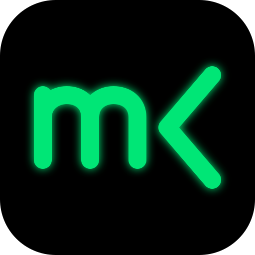

<div align="center">
  
  <h1>MacroCode</h1>
  <p><strong>Un terminal IA sous votre contrôle — apportez votre clé, gardez vos données.</strong></p>
  <p><a href="README.md">English</a> · <a href="README.tr.md">Türkçe</a> · <a href="README.de.md">Deutsch</a> · <strong>Français</strong> · <a href="README.ru.md">Русский</a></p>
</div>

## Qu'est-ce que MacroCode ?

MacroCode est une application de bureau open source et multiplateforme qui vous permet de
dialoguer et de travailler avec des modèles d'IA via une **interface de type terminal —
avec vos propres clés API** (BYOK). Construite avec Tauri v2 + React + TypeScript, elle se
présente comme un petit binaire natif et s'adresse aux développeurs qui aiment le texte,
les commandes et les outils pilotés au clavier.

Aucun serveur, aucun compte, aucune télémétrie : vos conversations sont stockées dans une
base SQLite locale, et vos clés ne quittent votre machine que sous forme d'en-têtes
d'authentification envoyés directement au fournisseur que vous avez configuré.

## Que peut-il faire ?

- **Dialoguer avec 7 fournisseurs** — Anthropic, OpenAI, Google Gemini, Ollama, OpenRouter,
  DeepSeek et xAI. Un fournisseur n'apparaît dans les listes qu'une fois sa clé saisie
  (ou, pour Ollama, une URL locale).
- **Choisir parmi des centaines de modèles** — un petit catalogue éditorial est enrichi
  avec les métadonnées de [models.dev](https://models.dev) : limites de contexte,
  capacités vision/raisonnement et tarifs.
- **Utilisation façon terminal** — commandes slash (`/model`, `/tokens`, `/compact`,
  `/help`…), historique des messages avec `↑ ↓`, comptage instantané des tokens à chaque tour.
- **Le laisser agir en agent** — désignez un dossier de projet avec `/root` : il peut lire
  des fichiers, fouiller le code, éditer des fichiers et exécuter des commandes shell.
  Chaque écriture/exécution passe par une carte d'approbation que vous acceptez ou
  refusez ; `rm` est restreint et les dossiers système sont bloqués. Il se connecte
  également aux serveurs MCP (stdio ou HTTP) pour des outils supplémentaires.
- **Maîtriser les coûts** — la mise en cache des prompts (breakpoints Anthropic / clés de
  cache compatibles OpenAI) allège les longues sessions ; `/tokens` indique précisément
  le coût de chaque tour, lectures du cache incluses.
- **Dans votre langue** — l'interface est intégralement traduite en Deutsch, English,
  Español, Français et Türkçe ; le changement s'applique instantanément, sans redémarrage.
- **Vos données restent les vôtres** — sessions en SQLite avec import/export JSON : tout
  est portable et utilisable hors ligne au besoin.

## Installation

Téléchargez le paquet correspondant à votre plateforme sur la page
[Releases](https://github.com/Geblkc/Macro-Code/releases)
(Linux `.deb` / `.AppImage`, Windows `.msi` / `.exe`, macOS `.dmg`).

Ou compilez depuis les sources :

```bash
npm install
npm run tauri dev    # application de bureau complète (Rust + dépendances Tauri requises)
npm test             # tests unitaires
```

## Premier lancement

1. Ouvrez **Paramètres** (ou tapez `/key`).
2. Collez la clé API de votre fournisseur et enregistrez. Pour [Ollama](https://ollama.com),
   une URL locale comme `http://localhost:11434` suffit.
3. Tapez un message — ou `/help` pour voir toutes les commandes.

## Documentation

- [`docs/ARCHITECTURE.md`](docs/ARCHITECTURE.md) — la structure du projet, module par module
- [`docs/MODELS.md`](docs/MODELS.md) — le catalogue de modèles et sa fusion avec models.dev
- [`docs/PACKAGING.md`](docs/PACKAGING.md) — construire `.deb` / `.rpm` / AppImage en local, installateurs Windows via CI
- [`docs/DEVLOG.md`](docs/DEVLOG.md) — journal daté de chaque changement
- [`CONTRIBUTING.md`](CONTRIBUTING.md) — recommandations pour les pull requests

## Licence

MIT — voir [`LICENSE`](LICENSE).
